<div align="center">

# OncoBiomarkerR

### From TCGA-LUAD RNA-seq to an annotated biomarker heatmap

This project compares gene activity in RNA-sequencing data from early-stage
(Stage I) and advanced-stage (Stage IV) lung cancer samples. It highlights genes
that differ between the groups and presents the findings in a heatmap and a
browser-ready report.

[](https://ranakgit.github.io/OncoBiomarkerR/)
[](https://www.r-project.org/)
[](https://bioconductor.org/)


**[Open the live report](https://ranakgit.github.io/OncoBiomarkerR/)** ·
[Browse the analysis](#-analysis-pipeline) ·
[Reproduce it](#-run-it-yourself)

</div>

---

## At a glance

| 40 tumor samples | 23,223 genes tested | 123 annotated hits | Stage-only model |
|:---:|:---:|:---:|:---:|
| 20 Stage I · 20 Stage IV | After low-count filtering | `padj < 0.05`, `|LFC| > 1` | `~ tumor_stage` |

> [!IMPORTANT]
> This is an exploratory comparison of a small cohort subset, not a clinically
> validated classifier. **No batch correction or batch covariate was used.**
> Stage association does not establish causation, therapeutic response, or
> clinical utility.

## What the analysis found

The strict annotation filter identified **123 genes** with adjusted
*p* < 0.05 and absolute shrunken log2 fold change > 1. The top Stage IV-up
results include:

| Gene | Shrunken log2 fold change | Adjusted *p* |
|:--|--:|--:|
| **COL2A1** | 6.50 | 0.00088 |
| **MAGEA12** | 5.80 | 0.00135 |
| **MAGEA3** | 5.70 | 0.00208 |
| **SEZ6** | 5.60 | 0.02400 |
| **CSAG1** | 5.11 | 0.00136 |

The DESeq2 summary also reports **277 up** and **222 down** at adjusted
*p* < 0.1. That is a more permissive threshold than the 123-gene annotation
filter above. In the heatmap, patients are clustered by expression—not sorted
by their known stage—and the two stages do not form perfectly separate groups.

## 🧬 Analysis pipeline

```mermaid
flowchart LR
    A["GDC<br/>TCGA-LUAD clinical + STAR counts"] --> B["Select<br/>20 Stage I + 20 Stage IV"]
    B --> C["SummarizedExperiment<br/>counts + clinical metadata + ranges"]
    C --> D["DESeq2<br/>~ tumor_stage"]
    D --> E["apeglm<br/>shrunken log2 fold changes"]
    E --> F["Significance filter<br/>padj &lt; 0.05 · |LFC| &gt; 1"]
    F --> G["GenomicRanges<br/>123 annotated biomarkers"]
    G --> H["ComplexHeatmap<br/>normalized expression Z-scores"]
    H --> I["Quarto<br/>standalone HTML report"]
```



### Tools used

`TCGAbiolinks` · `SummarizedExperiment` · `DESeq2` · `apeglm` ·
`GenomicRanges` · `ComplexHeatmap` · `Quarto`

## ✨ Explore the report

The report includes the top up-regulated genes, genomic coordinates, adjusted
*p*-values, and a stage-annotated expression heatmap.

<div align="center">

### [Launch the interactive report ↗](https://ranakgit.github.io/OncoBiomarkerR/)

*The heatmap uses unsupervised column clustering; stage colors are annotations,
not clustering inputs.*

</div>

<details>
<summary><strong>Prefer to inspect the code?</strong></summary>

- [Ingestion function](R/01_data_ingestion.R) ·
  [download script](analysis/02_fetch_tcga.R)
- [DESeq2 function](R/02_differential_expression.R) ·
  [analysis script](analysis/03_run_deseq2.R)
- [Genomic annotation function](R/03_genomic_annotation.R) ·
  [annotation script](analysis/04_annotate_biomarkers.R)
- [Heatmap function](R/04_visualization.R) ·
  [plot script](analysis/05_plot_heatmap.R)
- [Quarto source](analysis/clinical_report.qmd)

</details>

## 🚀 Run it yourself

### Requirements

- R 4.5 or a compatible version
- Internet access to the NCI Genomic Data Commons
- Quarto CLI on `PATH` to render the report

Install the R dependencies:

```r
if (!requireNamespace("BiocManager", quietly = TRUE)) {
  install.packages("BiocManager")
}
BiocManager::install(c(
  "TCGAbiolinks", "SummarizedExperiment", "dplyr",
  "DESeq2", "apeglm", "ComplexHeatmap", "circlize"
))
```

From the project root, run the milestones in order:

```powershell
Rscript analysis/02_fetch_tcga.R
Rscript analysis/03_run_deseq2.R
Rscript analysis/04_annotate_biomarkers.R
Rscript analysis/05_plot_heatmap.R
quarto render analysis/clinical_report.qmd
Copy-Item analysis/clinical_report.html index.html
```

The first step downloads the selected RNA-seq files and can take time.
Generated data and caches are intentionally excluded from Git. The heatmap
script writes a PDF during non-interactive runs; Quarto creates the detailed
HTML report, and `index.html` is the GitHub Pages entry point.

## Repository map

| Path | Purpose |
|:--|:--|
| [`R/`](R/) | Reusable ingestion, modeling, annotation, and plotting functions |
| [`analysis/`](analysis/) | Sequential pipeline scripts and Quarto report source |
| [`index.html`](index.html) | Self-contained GitHub Pages report |

---

<div align="center">

**Built with R + Bioconductor** ·
[Report](https://ranakgit.github.io/OncoBiomarkerR/) ·
[Source](https://github.com/RanakGit/OncoBiomarkerR)

</div>
